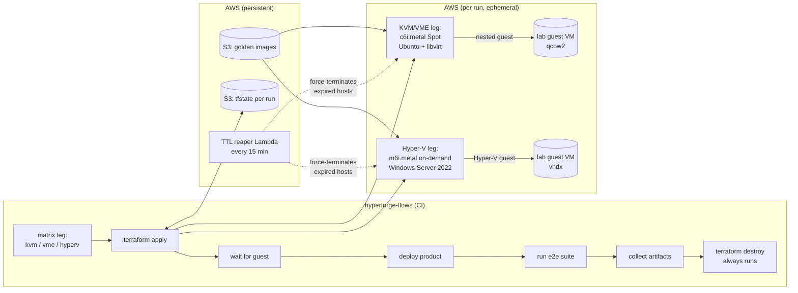

# HyperForge · core

**Ephemeral hypervisor test infrastructure on AWS.** HyperForge recreates
lab-hosted virtual machines (KVM, Hyper-V, HPE VM Essentials) in the cloud for
end-to-end product testing: every CI run forges a fresh hypervisor host, boots
a golden copy of the lab guest VM, deploys the product build, runs the e2e
suite, and destroys everything. Nothing persists between runs except images,
state history, and test artifacts.

This repo is the **Terraform layer** — the modules that provision and destroy
the hosts, and the safety net that guarantees nothing outlives its welcome.

## The HyperForge trio

| Repo | Role |
|------|------|
| **hyperforge-core** (this repo) | Terraform modules + per-run root module + TTL reaper |
| [hyperforge-bakery](https://github.com/HariBoddapati01/hyperforge-bakery) | Packer-built host AMIs + golden lab guest images |
| [hyperforge-flows](https://github.com/HariBoddapati01/hyperforge-flows) | CI orchestration: the e2e matrix workflow |

## Architecture



## Repository layout

```
modules/
  nested-kvm/     KVM + HPE VME leg — Linux host running libvirt/QEMU guests
                  (VME is KVM-based, so both legs share this module)
  hyperv-metal/   Hyper-V leg — Windows Server bare-metal host
  ttl-reaper/     Lambda + EventBridge schedule: kills expired test instances
envs/
  test/           Root module invoked per CI run (one leg per state file)
  shared/         One-time account bootstrap: buckets, network, OIDC, reaper
```

## Why every leg runs on `.metal`

AWS does **not** support nested virtualization on regular EC2 instances —
`/dev/kvm` does not exist there, and Hyper-V's hardware requirements are
stricter still. Both modules therefore default to bare-metal types:

| Leg | Default type | Pricing | Rationale |
|-----|-------------|---------|-----------|
| `kvm` / `vme` | `c6i.metal` | Spot (one-time) | Interruption is cheap: runs are idempotent and re-triggerable |
| `hyperv` | `m6i.metal` | On-demand | Metal Spot capacity is scarce; an interruption wastes ~10 min of provisioning |

If metal pricing becomes the dominant cost, the KVM/VME legs are portable to
GCP (nested KVM works on ordinary N2/C2 VMs there); the module boundary is
drawn so only module internals would change.

## Cost controls

1. **Ephemeral by construction** — `terraform destroy` runs under
   `if: always()` in CI; success, failure, or cancellation all tear down.
2. **Spot for the KVM/VME leg** — one-time requests, terminate on interruption.
3. **TTL reaper as backstop** — every instance carries `ephemeral-test=true`
   and a `ttl-expires-at` timestamp. The reaper Lambda sweeps every 15 minutes
   and force-terminates anything expired, independent of CI health — a crashed
   pipeline cannot leak a $4+/hr metal box overnight. Its IAM is tag-scoped:
   it can only terminate `ephemeral-test` instances. Ships with
   `dry_run = true`; flip to `false` after reviewing its CloudWatch logs.

## State model

One state file per run **and** leg — `runs/<run-id>-<leg>.tfstate` — passed at
init time:

```sh
terraform init \
  -backend-config="bucket=hyperforge-tfstate" \
  -backend-config="region=us-east-2" \
  -backend-config="key=runs/${RUN_ID}.tfstate"
```

No shared state means parallel matrix legs never contend, repeated runs never
collide, and a failed run's state remains inspectable afterwards.

## Usage (what CI runs per leg)

```sh
cd envs/test
terraform init -backend-config=...   # per-run key, see above
terraform apply -auto-approve \
  -var "run_id=${RUN_ID}" \
  -var "leg=kvm" \                   # kvm | vme | hyperv
  -var "subnet_id=subnet-..." \
  -var "security_group_id=sg-..." \
  -var "lab_image_s3_uri=s3://hyperforge-golden-images/golden/kvm/<sha>.qcow2"
# ... test ...
terraform destroy -auto-approve -var ...   # same vars
```

## One-time account setup

`envs/shared` is the single apply that bootstraps the account — run it once
with admin credentials (not CI):

```sh
cd envs/shared && terraform init && terraform apply
```

It creates the S3 buckets (versioned state with 90-day run-state expiry),
the egress-only test network (public subnet, no NAT gateway cost), the
test-host instance profile (SSM + golden-image reads), the GitHub OIDC
provider + CI role scoped to `hyperforge-flows`, and the TTL reaper (in
dry-run until you flip it). Its outputs map 1:1 onto the three GitHub
secrets hyperforge-flows needs.

Still manual: **service quota headroom** — `.metal` instances count against
On-Demand/Spot vCPU quotas (one `c6i.metal` is 128 vCPUs). Request increases
before the first run.

## Status

- [x] Terraform modules validated (`terraform validate`, AWS provider ~> 5.0)
- [x] One-time account bootstrap written (`envs/shared`) — not yet applied
- [ ] First real run pending golden images from hyperforge-bakery
